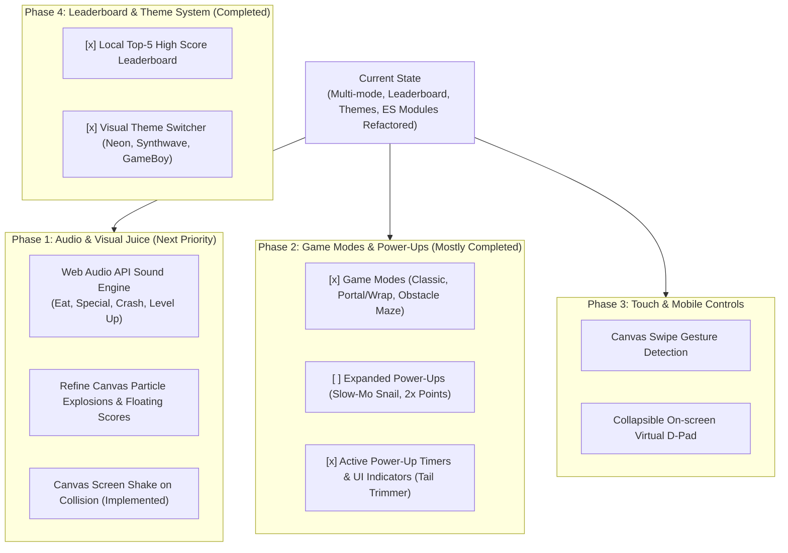

# 🐍 Modern Snake Feature Expansion Plan

## Feature Roadmap & Next Steps

This document outlines the proposed roadmap for expanding the **Modern Snake** game from its current playable state into a feature-rich, polished arcade experience. 



---

## ✅ Resolved Decisions

> [!IMPORTANT]
> **Zero External Dependencies Guideline**: All proposed audio uses the browser-native **Web Audio API** (synthesized tones), and visual effects are rendered natively on the HTML5 Canvas. No external audio files, npm packages, or bundlers are required.

> [!SUCCESS]
> **Code Organization Decision (Resolved)**: The project has officially adopted **native browser ES Modules** (`<script type="module">`). 
> - **Completed**: Extracted `config.js` (constants) and `storage.js` (localStorage logic) from the monolithic `main.js`.
> - **Next Step**: Decouple rendering logic (`draw*` functions) into a dedicated `renderer.js` module.

---

## Open Questions

> [!WARNING]
> Please review the following questions to help prioritize the next implementation step:

1. **Prioritization**: Which feature set would you like to build next?
   - **Option A (Recommended)**: *Sensory & Juice* — Web Audio sound effects + refined particle bursts.
   - **Option B**: *Mobile Controls* — Touch swipe gestures and virtual D-pad.
   - **Option C**: *Advanced Mechanics* — New power-ups (Snail, Speed Surge) and recording difficulty in the leaderboard.

---

## Proposed Changes & Progress Tracking

### Phase 0: Architecture Refactoring & Edge-Case Fixes (✅ Completed)
- **[x] Modularization**: Split `main.js` by extracting `js/config.js` and `js/storage.js`.
- **[x] Edge-Case Fix 1 (Time Freeze)**: Pausing the game now correctly freezes special food and active buff timers by extending their `expiresAt` timestamps upon resumption.
- **[x] Edge-Case Fix 2 (Smart Spawning)**: Updated `isCellOccupied` to predict the snake's next step, preventing food from spawning directly in front of the snake's head.

### Phase 1: Audio Synthesizer & Canvas Visual Juice (🚧 In Progress)
#### [MODIFY] `index.html` & `css/index.css`
- Add audio mute toggle button (🔊 / 🔇) in the header.
- Add sound toggle hint `<kbd>M</kbd> <span>Mute / Unmute</span>` to the instruction panel.
- Ensure screen shake animation (`.game-board.shake`) is robust. *(Already implemented)*

#### [MODIFY] `js/main.js` (or new `js/audio.js`)
- **Web Audio Sound Synthesizer**: Implement `AudioEngine` with `OscillatorNode` and `GainNode` for Eat, Special, and Crash sounds.
- **Particle System**: Refine `Particle` class for smoother burst effects and floating score labels. *(Basic implementation exists, needs polishing)*

---

### Phase 2: Game Modes & Advanced Power-Ups (✅ Core Completed)
#### [COMPLETED] `index.html` & `js/main.js`
- **[x] Game Modes**: Implemented `Classic`, `Portal` (wrap-around), and `Obstacles` (procedural generation with safe-zone checks).
- **[x] Tail Trimmer**: Implemented logic to halve snake length and display the active buff UI bar.

#### [TODO] Future Power-Ups
- 🐌 **Snail (Slow Motion)**: Reduces speed for 6 seconds.
- ⚡ **Speed Surge (Double Points)**: +2x multiplier on all food eaten for 8 seconds.

---

### Phase 3: Mobile Touch & Swipe Controls (⏳ Planned)
#### [MODIFY] `index.html` & `css/index.css`
- Add an optional virtual D-pad container (visible on screens <= 768px).

#### [MODIFY] `js/main.js`
- Attach `touchstart` and `touchend` listeners to `canvas` for swipe gesture detection.

---

### Phase 4: Local Leaderboard & Visual Theme Switcher (✅ Completed)
#### [COMPLETED] `index.html`, `css/index.css`, `js/storage.js`, `js/theme.js`
- **[x] Leaderboard**: Local Top-5 high score modal with date and game mode tracking.
- **[x] Theme Switcher**: CSS custom properties mapped to `[data-theme="synthwave"]` and `[data-theme="gameboy"]`, persisted in `localStorage`.

---

## Verification Plan

### Automated / Syntax Verification
- Syntax and script sanity check using browser console validation or Node.js:
  ```powershell
  # Check for syntax errors in JavaScript files
  node --check js/main.js
  node --check js/config.js
  node --check js/storage.js
  ```

### Manual Verification Checklist
1. **Architecture & Edge Cases (New)**:
   - [ ] Verify game runs correctly via local server (`serve` or Live Server), **not** via `file://` protocol.
   - [ ] **Time Freeze Test**: Spawn special food/buff, pause the game for 10 seconds, resume. Verify the timer did *not* count down during pause.
   - [ ] **Smart Spawn Test**: Play at high speed; verify food never appears exactly one grid cell in front of the snake's current direction.
2. **Audio Engine (Pending)**:
   - [ ] Start game, eat red food -> verify rising beep sound.
   - [ ] Toggle mute button (or press `M`) -> verify silence, refresh page -> verify muted state persists.
3. **Visual Particles**:
   - [ ] Eat food -> verify burst of particles flying outward and disappearing smoothly.
   - [ ] Verify floating score label (`+10` or `+30`) floats upwards and fades out.
4. **Game Modes**:
   - [ ] Select `Portal` mode -> head through left wall -> verify snake emerges seamlessly on the right side.
   - [ ] Select `Obstacles` mode -> verify static obstacle blocks appear and snake dies if it runs into them.
5. **Mobile Gestures (Pending)**:
   - [ ] Test touch swipe gestures using browser dev tools device simulation.
6. **Leaderboard & Themes**:
   - [ ] Check Top 5 scores update and survive page refresh.
   - [ ] Switch themes -> verify color palette changes smoothly across UI and canvas.
