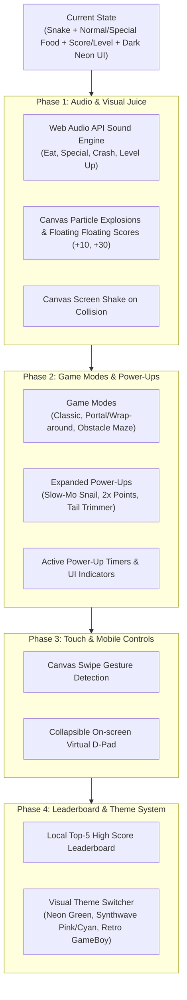

# 🐍 Modern Snake Feature Expansion Plan

## Feature Roadmap & Next Steps

This document outlines the proposed roadmap for expanding the **Modern Snake** game from its current playable state (normal food, special bonus items, difficulty settings, and dark neon UI) into a feature-rich, polished arcade experience.



---

## User Review Required

> [!IMPORTANT]
> **Zero External Dependencies Guideline**: All proposed audio uses the browser-native **Web Audio API** (synthesized tones with `OscillatorNode` and `GainNode`), and visual effects are rendered natively on the HTML5 Canvas. No external audio files, npm packages, or bundlers are required.

> [!TIP]
> **Modularity Question**: The game currently resides entirely in [main.js](file:///C:/Users/User/Desktop/js-study/Own%20Project/modern-snake/js/main.js) (701 lines). We can either keep it in a structured single file or split it into native browser ES Modules (`<script type="module">`) without needing Node.js or Vite. Please review Question 1 below.

---

## Open Questions

> [!WARNING]
> Please review the following questions to help prioritize the implementation order:

1. **Code Organization**: Would you prefer keeping the logic in [main.js](file:///C:/Users/User/Desktop/js-study/Own%20Project/modern-snake/js/main.js) or splitting it into native ES modules (e.g. `audio.js`, `particles.js`, `game.js`, `storage.js`)?
2. **Prioritization**: Which feature set would you like to build first?
   - **Option A (Recommended)**: *Sensory & Juice* — Web Audio sound effects + Canvas particle burst & floating score popups.
   - **Option B**: *Game Modes & Mechanics* — Portal mode (wrap around walls) + Obstacle mode + new power-up items.
   - **Option C**: *Leaderboard & Themes* — Local top-5 leaderboard modal + Color themes (Synthwave / GameBoy).
   - **Option D**: *Full Roadmap* — Step-by-step implementation through all phases.

---

## Proposed Changes

### Phase 1: Audio Synthesizer & Canvas Visual Juice

#### [MODIFY] [index.html](file:///C:/Users/User/Desktop/js-study/Own%20Project/modern-snake/index.html)
- Add audio mute toggle button (🔊 / 🔇) in the header next to game status.
- Add sound toggle hint `<kbd>M</kbd> <span>Mute / Unmute</span>` to the instruction panel.

#### [MODIFY] [css/index.css](file:///C:/Users/User/Desktop/js-study/Own%20Project/modern-snake/css/index.css)
- Style audio mute button with subtle neon border and glowing hover effect.
- Screen shake animation classes for `.game-board.shake`.

#### [MODIFY] [js/main.js](file:///C:/Users/User/Desktop/js-study/Own%20Project/modern-snake/js/main.js) (or `js/audio.js` + `js/particles.js`)
- **Web Audio Sound Synthesizer**:
  ```javascript
  const AudioEngine = {
    ctx: null,
    muted: localStorage.getItem("modern_snake_sound_muted") === "true",
    init() {
      if (!this.ctx) {
        this.ctx = new (window.AudioContext || window.webkitAudioContext)();
      }
    },
    playTone(frequency, type, duration, gainValue = 0.1) {
      if (this.muted) return;
      this.init();
      const osc = this.ctx.createOscillator();
      const gain = this.ctx.createGain();
      osc.type = type;
      osc.frequency.setValueAtTime(frequency, this.ctx.currentTime);
      gain.gain.setValueAtTime(gainValue, this.ctx.currentTime);
      gain.gain.exponentialRampToValueAtTime(0.0001, this.ctx.currentTime + duration);
      osc.connect(gain);
      gain.connect(this.ctx.destination);
      osc.start();
      osc.stop(this.ctx.currentTime + duration);
    },
    playEat() { this.playTone(520, "sine", 0.12, 0.15); },
    playSpecial() {
      [587, 740, 880, 1174].forEach((freq, idx) => {
        setTimeout(() => this.playTone(freq, "triangle", 0.15, 0.12), idx * 60);
      });
    },
    playCrash() { this.playTone(110, "sawtooth", 0.4, 0.25); }
  };
  ```
- **Particle System**:
  - `Particle` class with `x`, `y`, `vx`, `vy`, `color`, `alpha`, `life`.
  - Burst 8–14 particles whenever normal food or special food is eaten.
  - Floating floating score labels (`+10`, `+30`) moving upwards and fading out on the canvas.
- **Screen Shake**:
  - Apply CSS shake keyframes or 3-frame canvas translation jitter on wall/self collision.

---

### Phase 2: Game Modes & Advanced Power-Ups

#### [MODIFY] [index.html](file:///C:/Users/User/Desktop/js-study/Own%20Project/modern-snake/index.html)
- Add a "GAME MODE" dropdown next to "DIFFICULTY":
  - `Classic` (default, standard wall collision).
  - `Portal / Pass-Through` (screen wraps from left to right, top to bottom).
  - `Obstacles` (generates random brick blocks that snake must avoid).
- Add an Active Buff indicator bar above the canvas showing current power-up and progress meter.

#### [MODIFY] [js/main.js](file:///C:/Users/User/Desktop/js-study/Own%20Project/modern-snake/js/main.js)
- **Portal Mode Logic**:
  ```javascript
  if (gameMode === "portal") {
    if (head.x < 0) head.x = TILE_COUNT - 1;
    else if (head.x >= TILE_COUNT) head.x = 0;
    if (head.y < 0) head.y = TILE_COUNT - 1;
    else if (head.y >= TILE_COUNT) head.y = 0;
  }
  ```
- **Obstacles Mode**:
  - Store `obstacles = [{x, y}, ...]` generated away from snake spawn point.
  - Render as textured dark bricks or neon barriers with red warning borders.
- **New Power-Ups**:
  - 🐌 **Snail (Slow Motion)**: Reduces speed for 6 seconds.
  - ⚡ **Speed Surge (Double Points)**: +2x multiplier on all food eaten for 8 seconds.
  - ✂️ **Tail Trimmer**: Instantly trims 3 segments off snake tail.

---

### Phase 3: Mobile Touch & Swipe Controls

#### [MODIFY] [index.html](file:///C:/Users/User/Desktop/js-study/Own%20Project/modern-snake/index.html) & [css/index.css](file:///C:/Users/User/Desktop/js-study/Own%20Project/modern-snake/css/index.css)
- Add an optional virtual D-pad container (visible on screens <= 768px or toggleable in settings).
- Four touch buttons: Up, Down, Left, Right with high contrast and tactile active styles.

#### [MODIFY] [js/main.js](file:///C:/Users/User/Desktop/js-study/Own%20Project/modern-snake/js/main.js)
- Attach `touchstart` and `touchend` listeners to `canvas`:
  ```javascript
  let touchStartX = 0;
  let touchStartY = 0;

  canvas.addEventListener("touchstart", (e) => {
    touchStartX = e.touches[0].clientX;
    touchStartY = e.touches[0].clientY;
  }, { passive: false });

  canvas.addEventListener("touchend", (e) => {
    const diffX = e.changedTouches[0].clientX - touchStartX;
    const diffY = e.changedTouches[0].clientY - touchStartY;
    const minSwipe = 30;

    if (Math.abs(diffX) > Math.abs(diffY)) {
      if (diffX > minSwipe) changeDirection(1, 0);
      else if (diffX < -minSwipe) changeDirection(-1, 0);
    } else {
      if (diffY > minSwipe) changeDirection(0, 1);
      else if (diffY < -minSwipe) changeDirection(0, -1);
    }
  }, { passive: false });
  ```

---

### Phase 4: Local Leaderboard & Visual Theme Switcher

#### [MODIFY] [index.html](file:///C:/Users/User/Desktop/js-study/Own%20Project/modern-snake/index.html)
- Leaderboard button in header opening a modal dialog displaying Top 5 scores with date and difficulty.
- Theme selector in control footer or settings dropdown:
  - `Neon Matrix` (Default green)
  - `Synthwave 80s` (Neon Magenta & Cyan)
  - `Retro GameBoy` (Olive green / 4-shade monochrome)
  - `Amber Terminal` (Warm arcade orange)

#### [MODIFY] [css/index.css](file:///C:/Users/User/Desktop/js-study/Own%20Project/modern-snake/css/index.css)
- CSS custom properties mapped to `[data-theme="synthwave"]`, `[data-theme="gameboy"]`, etc.

#### [MODIFY] [js/main.js](file:///C:/Users/User/Desktop/js-study/Own%20Project/modern-snake/js/main.js)
- `loadLeaderboard()` and `saveLeaderboard(newScore, difficulty)` in `localStorage`.
- Update modal list dynamically.

---

## Verification Plan

### Automated / Syntax Verification
- Syntax and script sanity check using Node / ESLint if available, or browser console validation:
  ```powershell
  # Check for syntax errors in JavaScript files
  node -c js/main.js
  ```

### Manual Verification
1. **Audio Engine**:
   - Start game, eat red food -> verify rising beep sound.
   - Eat ⭐/💎 special food -> verify chord arpeggio.
   - Crash into wall -> verify crash buzz.
   - Toggle mute button (or press `M`) -> verify silence, refresh page -> verify muted state persists.
2. **Visual Particles**:
   - Eat food -> verify burst of particles flying outward and disappearing smoothly.
   - Verify floating score label (`+10` or `+30`) floats upwards and fades out.
3. **Game Modes**:
   - Select `Portal` mode -> head through left wall -> verify snake emerges seamlessly on the right side.
   - Select `Obstacles` mode -> verify static obstacle blocks appear and snake dies if it runs into them.
4. **Mobile Gestures**:
   - Test touch swipe gestures using browser dev tools device simulation.
5. **Leaderboard & Themes**:
   - Check Top 5 scores update and survive page refresh.
   - Switch themes -> verify color palette changes smoothly across UI and canvas.
